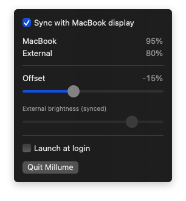

# Millume

A tiny macOS menu bar app that keeps your external monitor's brightness in sync with your MacBook's built-in display.

macOS already adapts the built-in display to the room using the ambient light sensor. Millume copies that brightness to your external monitor over DDC/CI, so both screens follow the light together.

<p align="center">
  
</p>

## Features

- **Sync**: the external monitor follows the MacBook's brightness, including automatic changes from the light sensor.
- **Offset**: one global offset from −50% to +50%. With −15%, a MacBook at 95% puts the monitor at 80%. The result is clamped to 5–100%, so the monitor never goes black.
- **Smooth transitions**: brightness fades over about a second, like the built-in display.
- **Lid closed**: when you close the lid, the monitor keeps the brightness it had just before. The menu then offers a manual slider. Opening the lid resumes syncing.
- **Gentle on the monitor**: only whole-percent changes are sent, intermediate values are dropped, and DDC writes are limited to one every 50 ms.
- **Launch at login**.

## Requirements

- macOS 13 Ventura or later
- A MacBook (or another Mac with a built-in display) and an external monitor that supports DDC/CI
- Apple Silicon or Intel. The app is a universal binary, though the Intel DDC path is less tested.

On M1 and some base M2 Macs, the built-in HDMI port doesn't pass DDC through. A USB-C to HDMI or DisplayPort adapter usually fixes that.

## Build and run

Needs Xcode or the Xcode Command Line Tools.

```sh
make run       # build build/Millume.app and launch it
make install   # copy it to /Applications (do this before enabling Launch at login)
make probe     # print what Millume can see, without changing any brightness
```

You can also open `Package.swift` in Xcode.

For troubleshooting, the binary has two command-line modes:

```sh
build/Millume.app/Contents/MacOS/Millume --probe    # built-in brightness, lid state, DDC displays found
build/Millume.app/Contents/MacOS/Millume --listen   # print brightness change notifications as they arrive
```

## How it works

1. **Reading the built-in display**: Millume subscribes to brightness change notifications from the private `DisplayServices` framework and reads the value with `DisplayServicesGetBrightness`. A 1 second poll stays on as a fallback and also watches the lid state (`AppleClamshellState`).
2. **Computing the target**: the MacBook's brightness plus the offset, clamped to 5–100%.
3. **Writing to the monitor**: the standard DDC/CI brightness command (VCP `0x10`) is sent over `IOAVService` on Apple Silicon, or through the framebuffer I²C interface on Intel.
4. **Lid handling**: while the lid closes, the panel can briefly report a brightness near 0. Millume holds off on sudden drops and, once the lid is closed, goes back to the value from about 2 seconds earlier.

Settings and the last brightness sent are kept in `UserDefaults`, so a fade after launch starts from where the monitor actually is.

## Limitations

- It uses private Apple APIs, so it isn't sandboxed and can't be distributed through the App Store.
- It assumes the monitor's DDC brightness range is 0–100, which is true for most monitors.
- The same brightness goes to every DDC-capable external monitor.

## License

[MIT](LICENSE) © 2026 Tapsiom
